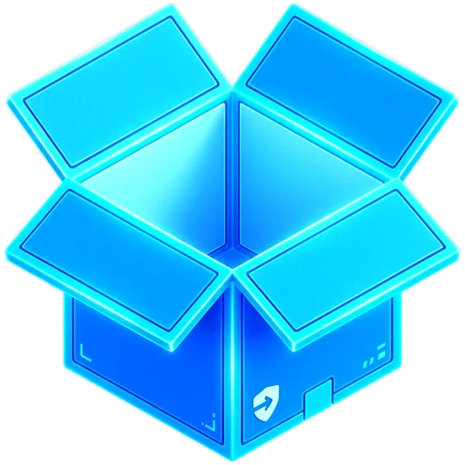
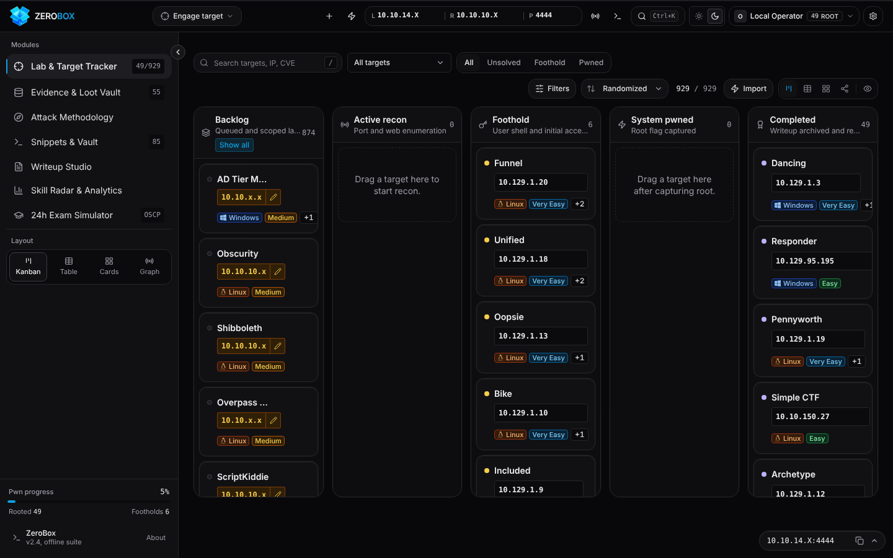
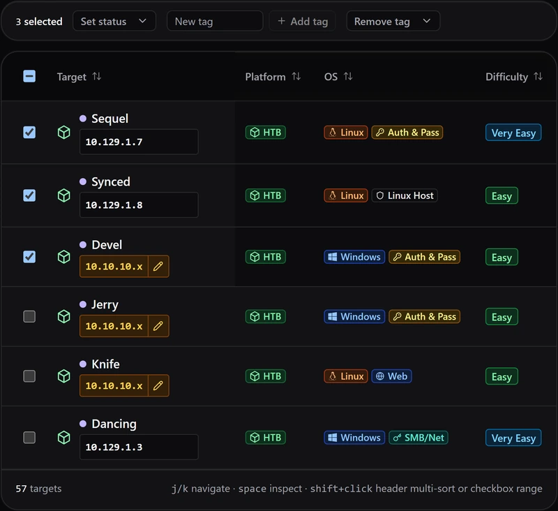
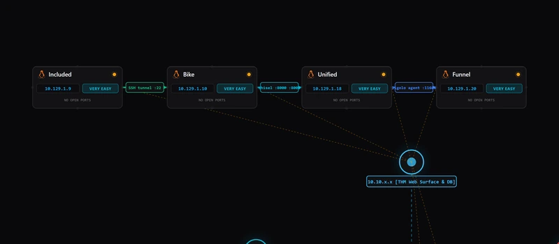
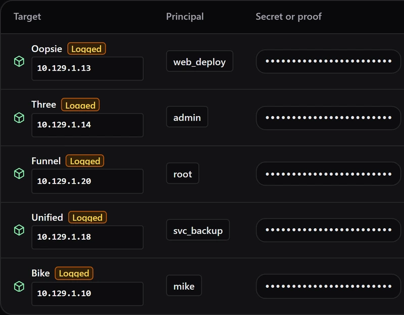
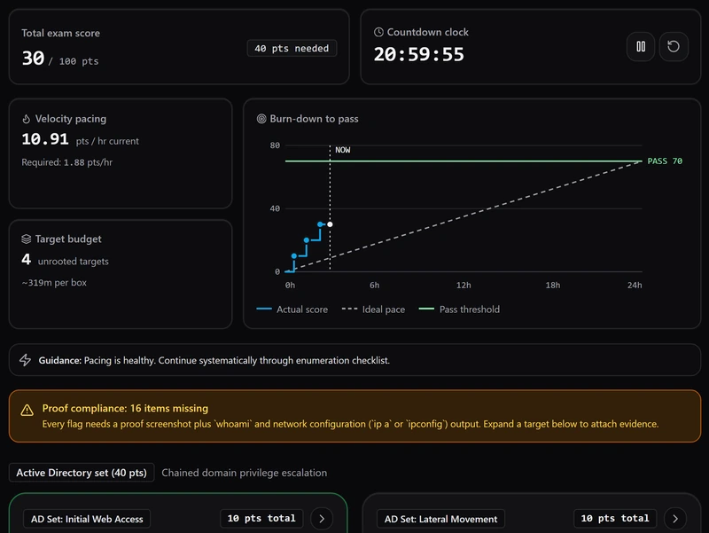

<div align="center">



# ZeroBox

### The free, offline CTF tracker for Hack The Box & TryHackMe

Track every box from recon to root, keep your loot and notes in one place, and prep for OSCP, CPTS and CRTO.
**No signup. No backend. No tracking.**

<br />

[](https://ctftracker.com/)

[](https://github.com/0xdnd/ctf-tracker/stargazers)
[](https://github.com/0xdnd/ctf-tracker/actions/workflows/ci.yml)
[](https://ctftracker.com/)
[](https://ctftracker.com/)
[-F59E0B?style=flat-square)](LICENSE)

<a href="https://ctftracker.com/"></a>

**[Try it live](https://ctftracker.com/)** · **[Features](#-features)** · **[Run locally](#-run-locally)** · **[FAQ](#-faq)** · **[Writeups](https://0xdnd.gitbook.io/thm-writeups/)**

</div>

---

## 🤔 Why ZeroBox?

Grinding for OSCP, CPTS or CRTO usually means progress scattered across browser tabs, a Notion page, a text file of creds and a cheatsheet you keep re-typing IPs into. ZeroBox puts it all in one place.

| Instead of… | ZeroBox gives you… |
|:---|:---|
| 📋 A messy spreadsheet of boxes | **1,027 HTB & THM machines** pre-loaded on a Kanban board, from *Backlog* to *Pwned* |
| 🔁 Editing `10.10.x.x` in every command | A **dynamic cheatsheet**: set `LHOST` / `LPORT` / `TARGET_IP` once and every command updates |
| 🐚 Googling "python reverse shell" again | **130+ reverse shells** with matching listeners, one click to copy |
| 🔑 Creds lost in random notes | A **loot vault** for every hash, key, flag and password you find |
| 😰 Wondering if you're exam-ready | A **24h exam simulator** with OSCP / CPTS / CRTO-style scoring |

> 🔒 **Private by design.** Everything lives in your browser (LocalStorage + IndexedDB). Nothing is sent anywhere.

---

## ✨ Features

<table>
<tr>
<td width="50%"></td>
<td width="50%"></td>
</tr>
<tr>
<td width="50%"></td>
<td width="50%"></td>
</tr>
</table>

### 🛡️ Lab & machine tracker
- **1,027-machine catalog:** active and retired HTB machines, Starting Point labs and THM CTF rooms, plus your own custom targets, Pro Labs and exams.
- **5-stage lifecycle:** Target Backlog → Active Recon → Foothold Obtained → System Pwned → Completed & Logged.
- **Five views:** Kanban board, sortable table, card grid, attack graph (with a pivot inspector) and curated cert pathways for OSCP, CPTS and CRTO.
- **Target dossier:** per-machine page with Nmap / scan import, a methodology checklist, flags and user/root timers.
- **Fast navigation:** `/` or `Ctrl+K` / `Cmd+K` for search and the command palette, plus filters with MITRE ATT&CK tags.

### 🗝️ Evidence & loot vault
- Credentials, hashes, flags, keys and tokens from every target in one place.
- Automatic hash-type identification for 20+ formats.
- Loot timeline, quick add, batch actions and export for reports.

### 🧭 Methodology & field manual
- Phase-by-phase attack methodology with decision branches and playbooks.
- Dynamic cheatsheet that injects your `LHOST`, `LPORT` and `TARGET_IP` into every command.
- Reverse shell generator: 130+ Linux and Windows payloads with listeners.
- Payload encoders, file-transfer and TTY-stabilisation cheatsheets.
- Obsidian-style notes workspace with multi-tab notes and a private IndexedDB vault.

### 📝 Writeups, analytics & exam prep
- Markdown writeup studio with live preview and pentest report templates, exportable as Markdown or HTML.
- Skill radar across Web, AD, Linux/Windows PrivEsc and Pivoting, plus a 90-day activity heatmap.
- 24h exam simulator with OSCP, CPTS and CRTO-style rules, scoring, breaks, evidence and a live burn-down chart.

### 🎨 Built well
- Dark (zinc / graphite / OLED) and light themes.
- WCAG 2.1 AA contrast, full keyboard navigation and `prefers-reduced-motion` support.
- One-click JSON backup and restore (optionally encrypted).
- Runs in the browser or as a native desktop app (Tauri).

---

## 🛠️ Run locally

**Requirements:** Node.js 18+ (tested on 24) and npm 9+.

```bash
git clone https://github.com/0xdnd/ctf-tracker.git
cd ctf-tracker
npm install
npm run dev        # start the dev server
```

| Command | What it does |
|:---|:---|
| `npm run build` | Production build |
| `npm run preview` | Serve the production build locally |
| `npm test` | Unit & component tests (Vitest) |
| `npx tsc --noEmit` | Type check |
| `npm run lint` | ESLint |
| `npm run test:e2e:pw` | Playwright end-to-end tests |
| `npm run tauri:dev` / `tauri:build` | Run or package the desktop app ([Tauri prerequisites](https://tauri.app/start/prerequisites/)) |

> **Windows shortcut:** after `npm install`, double-click `START-TRACKER.bat` to start the dev server and open the tracker.

**Tech stack:** React 18 · TypeScript · Vite · React Router 7 · Tailwind CSS · Zustand · Tauri · Vitest · Playwright

---

## ❓ FAQ

**What is a CTF tracker?**
A tool for keeping track of the capture-the-flag challenges you've started and finished. ZeroBox tracks HTB machines and TryHackMe rooms through each stage, from recon to root, and stores your flags, credentials and notes alongside them.

**Is it free?**
Yes. Free for personal and educational use, no account, no paywall. Open [ctftracker.com](https://ctftracker.com/) and start.

**Does it work offline? Where is my data?**
Everything is stored locally in your browser (LocalStorage + IndexedDB). There's no backend and nothing is uploaded. Export a JSON backup at any time.

**Which platforms are covered?**
556 retired and 20 active Hack The Box machines (active ones are name, OS, difficulty and link only), plus 451 TryHackMe CTF rooms. You can add custom targets from anywhere else: PG Practice, VulnHub or your own lab.

**Can I use it to prepare for OSCP or CPTS?**
Yes. There's a 24-hour exam simulator with OSCP, CPTS and CRTO-style scoring, a methodology checklist, and a cheatsheet that fills in your IPs and ports for you.

---

## 🤝 Contributing

Bug reports, ideas and pull requests are welcome. Read [CONTRIBUTING.md](CONTRIBUTING.md) first, then open an issue with the [bug report or feature request templates](https://github.com/0xdnd/ctf-tracker/issues/new/choose).

⭐ **If ZeroBox saves you time, [star the repo](https://github.com/0xdnd/ctf-tracker/stargazers).** It's the best way to help other hackers find it.

---

## 📜 Platform rules & compliance

ZeroBox is built to respect the terms of **Hack The Box** and **TryHackMe**.

<details>
<summary><b>Hack The Box (AUP §8.2 & §8.3)</b></summary>

- **No active-content disclosure:** active machines are metadata only (name, OS, difficulty, release date, official link), stored in `src/data/activeMachines.json`. Hints, solutions, flags, tags and notes are stripped from them, including anything you type yourself. The active list is maintained by hand and may lag behind HTB.
- **Retired content:** 556 retired machines are in the catalog; 141 of them (mostly retired since 2024) are listed by name, OS, difficulty and link only. HTB AUP §8.3 permits community walkthroughs and write-ups for retired content.
- **No Pro Labs or exams bundled:** no Pro Lab, Fortress or certification exam content ships with ZeroBox. You can only add them as personal targets you name and fill in yourself.
- **No scraping:** ZeroBox contains no scrapers, bots or crawlers targeting HTB (HTB UA §6.1).

</details>

<details>
<summary><b>TryHackMe (Terms of Use §3 & §5)</b></summary>

- Only public community challenge rooms are indexed (451 rooms; multiplayer / KoTH rooms excluded).
- The demo solved roster uses synthetic tokens (e.g. `THM{flag_captured_daniel_dayan}`), never real flags.
- No automated data extraction against THM infrastructure.

</details>

<details>
<summary><b>Private notes</b></summary>

- Course material (e.g. HTB Academy / CPTS modules) and private exam notes are never committed to this repository or bundled into builds.
- Imported notes and Obsidian vaults stay in your browser's IndexedDB (`zerobox_vault_db`).

</details>

**Disclaimer:** ZeroBox is an independent project and is **not affiliated with, endorsed by or sponsored by Hack The Box Ltd or TryHackMe Ltd**. "Hack The Box", "HTB", "TryHackMe" and "THM" are trademarks of their respective owners.

---

## ⚖️ License

ZeroBox is released under the **ZeroBox Source-Available Non-Commercial & Educational License (ZNSL 1.0)**.
Copyright © 2026 Daniel Dayan ([@0xdnd](https://github.com/0xdnd)). All rights reserved.

| | |
|:---|:---|
| ✅ **Allowed** | Clone, build and use ZeroBox for personal study, labs and CTF prep |
| ❌ **Not allowed** | Selling, renting, sub-licensing or otherwise monetizing it |
| ❌ **Not allowed** | Hosting a public instance or redistributing modified copies without written consent |
| ❌ **Not allowed** | Bundling it into paid courses, bootcamps or subscriptions |
| ⚠️ **Required** | Credit **Daniel Dayan** ([0xdnd.github.io](https://0xdnd.github.io/)) in any permitted mention |

See [LICENSE](LICENSE) for the full text.

---

<div align="center">

Made by **Daniel Dayan** ([@0xdnd](https://github.com/0xdnd))

[Portfolio](https://0xdnd.github.io/) · [LinkedIn](https://www.linkedin.com/in/daniel-dayan-a66322352/) · [GitBook writeups](https://0xdnd.gitbook.io/thm-writeups/) · [Buy Me a Coffee](https://buymeacoffee.com/0xdnd)

</div>
